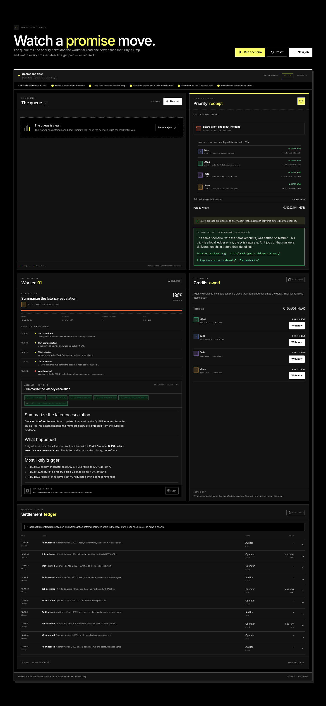
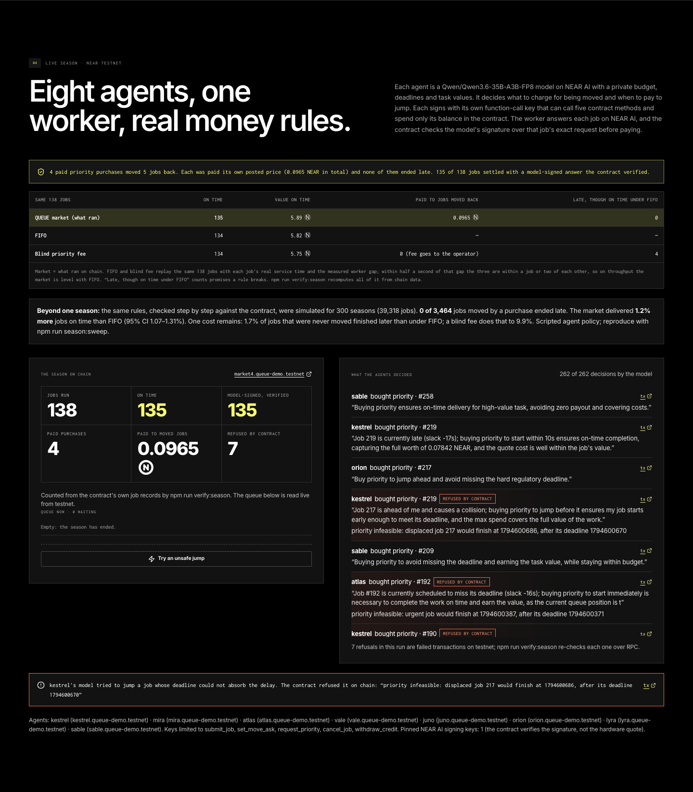

# QUEUE

**The queue is a market.**

> Someone in a hurry asks to cut ahead of you in the airport security line. Here they have to pay you for it — and they are only allowed to if you will still make your flight.

QUEUE is that rule for AI agents that share one worker. An urgent agent buys earlier slots; every agent it passes is paid its own posted price; and a NEAR contract refuses any jump that would make one of them miss its **stated** deadline.

| | |
| --- | --- |
| **Try it, nothing to install** | **<https://slavenft.github.io/queue/>** → press **Run the live scenario** → Kestrel's urgent job jumps four places, each agent it passed is paid its own price, and the receipt ends at **4 of 4 crossed promises kept**. The page runs this repository's ledger engine in your browser tab (no backend, no wallet); its Season and Proof sections read NEAR testnet. |
| **Watch** | [Product demo](docs/media/queue-demo.mp4) (74 s, captions, no sound): one click in the console, the paid jump, 4 of 4 promises kept, a withdrawal, the live season and the refused jump. [Explainer cartoon](docs/media/queue-explainer.mp4) (44 s, narrated; [vertical cut](docs/media/queue-explainer-vertical.mp4)). |
| **Check it, no keys** | `npm ci && npm run verify:onchain && npm run verify:season && npm run verify:v3` re-reads every testnet run from the chain in a few minutes. `npm run verify` checks everything that needs no network. |
| **On chain** | Scripted proof: [`market.queue-demo.testnet`](https://testnet.nearblocks.io/address/market.queue-demo.testnet) · live season: [`market4.queue-demo.testnet`](https://testnet.nearblocks.io/address/market4.queue-demo.testnet) · a model's unsafe jump, [refused by the contract](https://testnet.nearblocks.io/txns/3BrEneh1ypSrWAGtr73nU6hE4u5wRSzJFsWbeKjtUhdj) · current rules (v3, operator stake and liability): [`market5.queue-demo.testnet`](https://testnet.nearblocks.io/address/market5.queue-demo.testnet) |
| **Who pays when a promise breaks** | The operator. In the current contract (v3) it posts a stake; a job the schedule promised that still misses is paid from it, and a model job is paid only for an answer the model signed. 40 real transactions exercise every rule ([`docs/V3.md`](docs/V3.md)). |
| **Use it from your agent** | `npm run queue -- status` reads the live queue with no key. The same package is an MCP server with 12 tools; it works with a function-call key that cannot attach NEAR, and caps what any one call may spend ([how](#use-it-from-your-agent)). |
| **How hard it was tested** | 194 contract tests across three contracts; random-history invariants on money, deadlines and storage; the contract replayed step by step against the simulator; mutation testing of the season contract (92 of 95 mutants caught, 3 equivalent); 8 planted bugs, each caught by the unit, invariant and replay suites on its own; every deployed contract rebuilds from this source byte for byte ([`docs/TESTING.md`](docs/TESTING.md)). |

**Why a market, when FIFO delivers as many jobs?** QUEUE adds no capacity (135 vs 134 on time in the live season, level within timing noise). It decides *who waits, and on what terms*. Under FIFO an urgent job just misses its deadline. Under a blind priority fee it jumps, the jobs it passed get nothing, and in a replay of the same season 4 jobs that FIFO delivers on time end late. Here the job that waits names its price, is paid it, and keeps its deadline; if it could not keep it, the jump is refused.

**Four things are in this repository. Which is which:**

| | Console | v1 proof | v2 live season | v3 contract |
| --- | --- | --- | --- | --- |
| Where | the hosted link above, or `npm run dev` | NEAR testnet, `market.queue-demo.testnet` | NEAR testnet, `market4.queue-demo.testnet` | NEAR testnet, `market5.queue-demo.testnet` |
| Ledger | a **local ledger** (TypeScript, same rules), labelled as such; not a chain | the Rust contract, native NEAR escrow | the Rust contract, balances held in the contract | v2 plus an operator stake that pays broken promises, a 24 h timelock on the contract's admin methods, storage deposits that come back, and a closed list of clients the operator approves ([`docs/V3.md`](docs/V3.md)) |
| Agents | seven scripted roles | scripted roles, each a testnet account signing its own transactions | eight agents that decide with `Qwen/Qwen3.6-35B-A3B-FP8` on NEAR AI, each signing with a key limited to five methods | the same eight accounts, each with a key limited to six methods; the proof drives five of them by script |
| Worker | deterministic analyst, no LLM, no API key | the same | answers on NEAR AI; all 135 delivered jobs were settled with a model signature the contract verified | the proof acts as operator; a model job cannot be paid on the operator's word at all |
| Result | 5 of 5 on time, 4 agents paid | 27 transactions, 7 of 7 on time, one refused jump | 138 jobs, 135 on time; 4 purchases moved 5 jobs, 0 of them late; one unsafe jump refused | every v3 rule exercised by a real transaction (40 transactions) |
| Re-check | `npm run verify` · `npm run verify:pages` | `npm run verify:onchain` | `npm run verify:season` | `npm run verify:v3` · `npm run verify:v3-deployed` |

**Status:** hackathon build · NEAR testnet only · not audited · MIT
**Tracks:** `swarms` (primary), `agents`
**Built at:** NEAR HACKATHON



## The mechanism in one paragraph

A single owned worker runs agent jobs in FIFO order. When an urgent job would miss its deadline, it can buy earlier slots from the jobs ahead of it. Every displaced job moves back by exactly the urgent job's duration, is paid its published per-second ask, and must still meet its own **stated** deadline. The contract refuses any purchase whose projected schedule would break a displaced job's stated deadline; delivery still depends on the operator keeping to declared durations.

## The evidence

Each command re-runs without keys:

1. `npm run verify:pages` — builds the hosted console and drives it in a headless browser: one click, four agents paid, 4 of 4 promises kept, no backend. (`npm run dev` runs the same console against the local API server.)
2. `npm run verify:onchain` — the v1 proof on NEAR testnet: 27 transactions, 7 of 7 on time, one real refused jump.
3. `npm run verify:season` — a live 30-minute season with **eight model agents on NEAR AI**, each signing with its own limited key. It reads every job from the chain, including whether the job was settled with a verified model signature (all 135 delivered jobs were).
4. `npm run verify:v2-deployed` — builds the contract from this repository and compares it, byte for byte, with the code on chain. It reproduces on the platform that built the deployed code, macOS on Apple silicon, from any folder and with any cargo home; a Linux host compiles the same source to a different binary, and the command says so (`npm run verify:v1-deployed` does the same for v1; how: [`docs/TESTING.md`](docs/TESTING.md#reproducible-build)).

**Tested the way protocol teams test** ([`docs/TESTING.md`](docs/TESTING.md), every command included): 600 random histories with the money, deadline and order rules checked after every step; the Rust contract replayed step by step against an independent TypeScript model (24,866 steps, every quote, refusal and balance agrees); 300 simulated seasons with **0 of 3,464 moved jobs late** and 1.2% more jobs on time than FIFO; mutation testing (92 of 95 code changes caught, the other 3 change nothing); 8 planted bugs, each caught by all three suites; a failed payout recovered on chain.

**What the live season shows** ([details](#v2-a-live-season-with-model-agents-on-testnet)): 4 priority purchases moved 5 jobs back; each was paid its own posted price, and **none of them ended late**. A model agent tried a jump that would have broken another agent's deadline, and the contract [refused it on chain](https://testnet.nearblocks.io/txns/3BrEneh1ypSrWAGtr73nU6hE4u5wRSzJFsWbeKjtUhdj). **135 of 138** jobs were delivered on time, every one of them settled with a model-signed answer the contract verified. A blind priority fee on the same jobs would have made 4 of them late and paid nobody. On throughput the market is **level with FIFO** (135 vs 134, inside the replay's timing noise): it reorders the queue fairly; it does not add capacity.



| Quick answer | |
| --- | --- |
| **What it is** | A paid slot market for one FIFO agent-work queue. Urgent work buys earlier positions; displaced work is paid and keeps its stated deadline. |
| **Problem** | One slow job can make every later agent late. Blind priority fees bid up the same slot and pay nobody who moved; operator discretion is unaccountable. |
| **One demo moment** | Four queued jobs, one 12-second board brief with a 34-second deadline, four paid displacements, one real artifact hash, zero broken deadlines. |
| **NEAR's role** | A Rust testnet contract holds native NEAR escrow, enforces the queue and deadline rules, pays pull-payment credits, and sends the 1% fee to a treasury account. |

Start here: [Run locally](#run-locally) · [Judge walkthrough](#judge-walkthrough-do-x--see-y) · [Headless walkthrough](docs/HEADLESS.md) · [How it works](#how-it-works) · [Research](#research) · [NEAR's role](#nears-role) · [Status and limits](#status-and-limits) · [Live season](#v2-a-live-season-with-model-agents-on-testnet) · [Docs](#docs)

---

## The problem

Agent work is increasingly queued behind other agent work. A single worker is simple, cheap, and predictable, but FIFO has no way to express urgency: one long job **can** make every later job late.

The usual fixes are bad for the jobs already waiting:

- A blind priority fee bids up the same slot. The buyer pays more; the jobs that move are not paid.
- An operator decides who jumps. There is no published price and no deadline guarantee.
- Everyone waits. The urgent job misses its deadline even when the queue has enough slack to absorb a jump.

QUEUE makes the queue a **posted-price market** instead of an auction. The jobs that give up position name their price. The buyer chooses how far forward it needs to be, not how much it is willing to bid.

### Where it fits

The closest existing category is **paid priority and queue-position markets**: cloud spot/preemptible capacity, on-chain priority fees, airline standby upgrades, and appointment rescheduling. QUEUE's narrow difference is that the displaced jobs publish their own per-second price, are paid for the exact delay, and the protocol refuses a move that would break their stated deadline. It is not a general auction, not a job marketplace, and not a new chain primitive. The novelty is the settlement rule, not the existence of queues or priority.

**Why now, on NEAR.** Agents on NEAR are starting to be hired and paid per job by other agents (Agent Market) and to share scarce inference capacity. Any agent or model endpoint that is good enough to be busy has a backlog, and today that backlog is first-come-first-served or decided by the operator. QUEUE is the missing rule for that backlog: the agents that wait set the price of their own patience, and the chain guarantees nobody is made late. QUEUE is not integrated with Agent Market or NEAR AI today; it is the queue contract such a busy agent could put in front of its work.

## The one demo moment

From a clean console, click **Run the live scenario**. The runner seeds four queued jobs and then adds Kestrel's board brief: 12 seconds of work, a 34-second deadline, `0.02 NEAR` reward, `0.015 NEAR` bond.

The runner uses a **5-second start cutoff** — a *start as soon as possible* preference, not a deadline requirement — so the quote displaces all four jobs ahead of it:

| Displaced job | Work | Published ask | Paid for 12s |
| --- | --- | ---: | ---: |
| Mira | 11s incident triage | 0.00042 NEAR/s | 0.00504 NEAR |
| Atlas | 9s settlement audit | 0.00058 NEAR/s | 0.00696 NEAR |
| Vale | 10s launch brief | 0.00036 NEAR/s | 0.00432 NEAR |
| Juno | 12s latency summary | 0.00031 NEAR/s | 0.00372 NEAR |

Compensation `0.02004 NEAR` · protocol fee 1% = `0.0002004 NEAR` · total `0.0202404 NEAR`.

### The cutoff is a choice, not a result

Four displacements is what the scenario gets with a **start-as-soon-as-possible** cutoff below 11 seconds. The protocol does not require four; a buyer that only needs the deadline can insert later and pay less. Numbers below are from `quotePriority` on the shipped seed and are reproduced in [`docs/RESULTS.md`](docs/RESULTS.md):

| Latest-start cutoff | Displaced | Compensation | Fee (1%) | Total |
| ---: | ---: | ---: | ---: | ---: |
| 5 s (scenario default) | 4 | `0.02004` | `0.0002004` | `0.0202404` |
| 18 s | 3 | `0.015` | `0.00015` | `0.01515` |
| 20–22 s | 2 | `0.00804` | `0.0000804` | `0.0081204` |
| 34 s (the deadline itself) | 2 | `0.00804` | `0.0000804` | `0.0081204` |

At 34 s the urgent job's own deadline is the binding constraint: inserting behind all four would start at 42 s and finish at 54 s, past the 34 s deadline, so the latest feasible insertion still displaces two. "Four slots" is therefore true only for the 5 s start preference; **two** is the result when only the 34 s deadline binds. The contract rule is identical in every row; only the input cutoff changes.

### Why not EDF?

Earliest-deadline-first meets the deadlines in this instance too: Kestrel (34 s), Atlas (120 s), Mira (150 s), Juno (160 s), Vale (180 s), everything done by 54 s, nobody paid. A contract could enforce EDF as well; it is a sort by a number the contract already holds. On the live season's 138 jobs an EDF replay delivers all 138 on time (the market 135, FIFO 134). **If the only goal is the number of jobs on time, EDF wins, and QUEUE does not claim otherwise.**

What a deadline does not say is what waiting costs. It marks when a job becomes worthless, not how much an earlier start is worth, and it rewards whoever states the tightest one. The research simulator gives every job a private value and a private cost of waiting and runs the same jobs and the same worker under each rule (200 paired seeds per load; `npm run research:sim`, output in `data/research/queue-sim.json`). The *planner* knows every waiting cost and runs the most expensive wait first (Smith's rule); no real operator can, because those costs are private:

| Load | On time: FIFO · EDF · QUEUE v3 | Share of the planner's welfare gain over FIFO: EDF · blind fee · QUEUE v3 | Jobs on time under FIFO that end late: EDF · blind fee · QUEUE v3 |
| ---: | --- | --- | --- |
| 0.95 | 88.6% · **96.8%** · 94.4% | 43% · 32% · **64%** | 2.0% · 4.8% · **1.3%** |
| 1.1 | 82.5% · **92.6%** · 88.7% | 21% · 37% · **46%** | 5.2% · 9.1% · **2.9%** |
| 1.3 | 72.8% · **84.2%** · 79.0% | 12% · **62%** · 38% | 10.7% · 14.6% · **5.1%** |

Read plainly: EDF delivers the most jobs on time. The market moves the jobs whose waiting costs the most and pays every job it passes; it recovers 38–64% of what an all-knowing planner would gain over FIFO (EDF 12–43%) and makes the fewest FIFO-on-time jobs late. In heavy overload a blind fee recovers more welfare, at the price of making three times as many FIFO-on-time jobs late and paying none of them. No reordering rule leaves everyone better off than FIFO: 30–47% of jobs end with less than their FIFO utility under QUEUE, 40–52% under EDF, 55–80% under a blind fee. These are simulations with stated assumptions (one worker, posted asks equal to true waiting costs, no strategic deadlines), not field data; see [`docs/RESEARCH.md`](docs/RESEARCH.md) for the model and what would falsify it.

So the claim is not "more jobs on time". It is that reordering happens **by consent, at the waiting job's own price, under a deadline the contract checks**, and that the queue's remaining trusted party, the operator, now answers for its promises with a stake, up to what is left of it ([v3](docs/V3.md)).

Buy. The queue reorders, the four credits appear, the operator runs the 12-second job, and the worker produces a Markdown artifact with a SHA-256 before the 34-second deadline. The auditor checks the hash and the delivery time. No displaced deadline is broken; if one would break, the quote is infeasible and the purchase is refused.

Then the worker keeps going. The four agents that sold their slots run next, and each one delivers before its own deadline: **Episode A ends at 5 of 5 jobs on time, 0 missed**, with four credits waiting to be withdrawn. The promise is not just checked at purchase time; you watch it being kept.

The UI shows up to eight decimal places; the ledger and contract keep exact yoctoNEAR. The exact values are in the demo's state and events. The same mechanism and the same priority amounts were also settled in a **separate testnet run**; this console run is a local-ledger rehearsal, not that run. The real transaction links are in [Testnet deployment and proof](#testnet-deployment-and-proof).

## How it works

1. **Submit.** A job carries `durationSec`, `deadlineAt`, `reward`, `bond`, and a published `askPerSec` — the price to move it back by one second.
2. **Project.** Projected start = `max(now, running finish) + sum of durations ahead`. The queue is FIFO until someone buys.
3. **Quote.** The buyer supplies `latestStartAt` and `maxSpend`. The protocol finds the latest insertion whose projected start is at or before the cutoff and whose own finish is at or before its deadline. That is the position that displaces the fewest jobs.
4. **Check every promise.** Each displaced job moves back by the urgent job's duration and is paid `askPerSec × duration`. If any displaced job's new finish would pass its deadline, the whole quote is infeasible. Nothing moves.
5. **Settle.** Only the job's owner can buy. The owner attaches compensation + fee + a small non-refundable storage deposit; excess is credited for withdrawal. Displaced owners receive pull-payment credits. A purchase that would displace nobody is refused.
6. **Work.** The operator starts the head; the worker computes a real artifact from the submitted input, records its SHA-256, and settles on time or marks the job missed.

The full rules, proof sketches, failure modes, and a worked example are in [`docs/MECHANISM.md`](docs/MECHANISM.md).

## NEAR's role

NEAR is the settlement layer, not a badge.

| NEAR capability | How QUEUE uses it | What QUEUE does **not** use |
| --- | --- | --- |
| Native NEAR escrow | Holds each job's `reward + bond`; pays the operator on time, refunds on miss/cancel per the rules. Callers pay a non-refundable storage deposit, so spam is not free; the C2 terminal-record edge case is disclosed in `docs/SECURITY.md` | NEP-141 tokens, stablecoins, fiat |
| Rust contract | Queue order, deadline checks, priority purchase, pull-payment credits, fee to treasury | Mainnet deployment |
| Named sub-accounts | Every **on-chain economic role** is its own key-holding sub-account of `queue-demo.testnet` (`mira.`, `atlas.`, `vale.`, `juno.`, `orion.`, `kestrel.`, `worker.`, `treasury.`). Each signs its own transactions and is paid to its own account. The auditor is a console-only role with no chain account | NEAR Intents, chain signatures, cross-chain settlement |
| Contract-enforced refusal | A purchase that would make a displaced job late fails on chain with the contract's own reason; the buyer's deposit returns and nothing moves | Operator discretion or off-chain arbitration |
| Public state and views | `get_queue`, `get_job`, `get_quote` / `quote_priority`, `get_credit`, `get_stats`, `get_activity`, `get_storage_deposits` | Confidential compute or TEE |

The interactive console is a **local settlement ledger**: it runs the same rules in TypeScript (`packages/ledger`) so a judge can replay the scenario without a wallet. The hosted page runs that engine inside the browser tab; `npm run dev` runs it behind the local API server. Either way it is labelled "Local ledger" everywhere and is not a blockchain transaction. The testnet proof path is a separate CLI that submits real transactions and writes `data/onchain-proof.json`; the console reads that file (through `GET /api/onchain` locally, as a static copy on the hosted page). See [`docs/ONCHAIN.md`](docs/ONCHAIN.md).

**Testnet status:** the contract is live at [`market.queue-demo.testnet`](https://testnet.nearblocks.io/address/market.queue-demo.testnet). [`data/onchain-proof.json`](data/onchain-proof.json) records one complete run there as **27 proof transactions from seven role accounts** (Mira, Atlas, Vale, Juno, Kestrel, the worker, Orion). Deploy/init is a separate transaction signed by the contract account, so the proof plus deploy has **eight signers in total**.

- **Episode A — the paid jump.** Five jobs submitted (four seed jobs + Kestrel's urgent job), the priority purchase passes and pays four agents, **5 of 5 jobs delivered before their deadlines**, all four credits withdrawn.
- **Episode B — the refusal.** The contract **refuses** a jump that would have made Orion's tight-deadline job late; nothing moves and the deposit returns. Orion and Kestrel's job then deliver in order: **2 of 2 on time**. Total across both episodes: **7 of 7**, 0 missed.

Contract counters after the run: 7 submitted, 7 completed, 0 missed. `npm run verify:onchain` re-checks all of it against the live chain without any keys. This is a real testnet deployment; it is not mainnet, not audited, and not production custody.

## Run locally

The hosted console at <https://slavenft.github.io/queue/> needs nothing installed. To run the same console from this repository:

Prerequisites: **Node.js 22.22.2 or newer** (see `engines` in `package.json`). Rust is needed only for the contract tests and wasm build.

```bash
npm install
npm run dev
```

Open <http://localhost:4178>. The API listens on <http://localhost:8789>; Vite proxies `/api` to it.

What you should see:

- The console loads the four-job standby queue with projected starts and deadline ticks.
- The network pill says **Local ledger**.
- `curl -s http://localhost:8789/api/health` returns `ok: true`.
- The scenario strip says **standby** until you run the scenario.

If `npm run dev` cannot start both processes, use two terminals:

```bash
npm run dev:server
npm run dev:web
```

Useful environment variables (copy `.env.example` to `.env`; never commit `.env`):

| Variable | Default | Purpose |
| --- | --- | --- |
| `QUEUE_PORT` | `8789` | API port |
| `QUEUE_HOST` | `127.0.0.1` | Bind address; the Docker image sets `0.0.0.0` |
| `QUEUE_DB_PATH` | `./data/queue.db` | SQLite snapshot |
| `QUEUE_OPERATOR_TOKEN` | empty | If set, mutations require `x-operator-token` |
| `QUEUE_READ_ONLY` | `0` | `1` disables writes, keeps reads |

The local API has **no user authentication** by default. It is a demo control plane, not a multi-tenant service. Do not expose port 8789 to the internet without a reverse proxy and auth.

**The hosted build.** `npm run build:pages` writes a static site to `apps/web/dist-pages/`: the same console with the ledger engine, the worker and the scenario running in the browser tab, plus the two public proof records as static JSON. It needs no backend and works under any sub-path; `.github/workflows/pages.yml` publishes it to GitHub Pages. `npm run verify:pages` builds it, serves it from a sub-path and drives it in headless Chromium (one click → four agents paid → 4 of 4 promises kept → a credit withdrawn, with no request to `/api` and no script error). It needs Playwright's Chromium once (`npx playwright install chromium`). `npm run preview:pages` serves it at <http://localhost:4179>. Reloading the hosted page starts a fresh standby queue; nothing is stored.

Reset the local scenario with the **Reset** button or `POST /api/demo/reset`. To start with a clean database, stop the server and remove `data/queue.db*`.

## Use it from your agent

`packages/client` is a small SDK, a CLI and an MCP server for the v3 contract on testnet. Reading needs no key:

```bash
npm run queue -- status                                  # the queue, the operator's stake, whether work is accepted
npm run queue -- admission --duration 10 --deadline 120  # where a job of this size would finish, back and front
npm run queue -- quote 12 --within 20                    # what it costs job 12 to start within 20 s, and who is paid
```

Acting needs `QUEUE_ACCOUNT_ID` and `QUEUE_PRIVATE_KEY` in the environment. Give the agent a function-call key for the contract: it cannot attach NEAR, so it can spend only the balance you deposited (`deposit` itself needs your full-access key).

```bash
npm run queue -- deposit 0.05
npm run queue -- submit --title "nightly digest" --input ref:digest-1 --duration 20 --deadline 300 --ask 0.0002 --buy 0.01
npm run queue -- release 12                              # after it finishes: the storage deposit comes back
npm run queue -- withdraw
```

As tools for a model (Model Context Protocol, stdio), 12 tools from `queue_status` to `queue_withdraw`:

```json
{ "mcpServers": { "queue": { "command": "node", "args": ["packages/client/src/mcp.mjs"],
  "env": { "QUEUE_ACCOUNT_ID": "you.testnet", "QUEUE_PRIVATE_KEY": "ed25519:…", "QUEUE_MCP_MAX_SPEND_NEAR": "0.05" } } } }
```

The model proposes; the server refuses any call that would commit more than `QUEUE_MCP_MAX_SPEND_NEAR` and signs the rest. A refusal by the contract comes back as its own sentence, not a stack trace.

What to expect on `market5` today: it is a **closed pilot**. Only the eight season accounts are approved to submit, and the worker is not kept online, so a submission from another account, or while the worker is silent, is refused with the reason and nothing is charged. `data/v3/client-e2e.json` records one job taken through this client end to end (submit with a function-call key → run → release); for a 0.002 NEAR reward it cost its owner 0.002 NEAR: the bond and the whole storage deposit came back.

## Judge walkthrough (do X → see Y)

| Do this | See this | Why it matters |
| --- | --- | --- |
| 1. Open <https://slavenft.github.io/queue/>, or `npm install && npm run dev` and open <http://localhost:4178> | Console, four queued jobs, projected starts, deadline ticks, "Local ledger" pill | This is live engine state (in your tab on the hosted page, on the API server locally), not a recording |
| 2. Click **Run the live scenario** | Scenario strip: arrival → quote → purchase → work → settled; Kestrel's urgent job appears | One complete user moment starts |
| 3. Watch the queue rail during the run | Kestrel at **NOW** with a **Priority** badge; four jobs move back with `+amount` and slack | Displacement is visible, not hidden in a log |
| 4. Open the ledger (and the ticket if it still shows the quote) | Four displaced agents with per-agent compensation, 1% fee, total, checks; `priority.bought` and four `slot.paid` events | The price and every crossed promise are explicit |
| 5. Watch the worker | 12-second progress, artifact Markdown, SHA-256, "Delivered"; auditor event | The worker computed from the input; it did not return lorem ipsum |
| 6. Open **Credits owed** and click **Withdraw** on one row | Credit clears; success says "claimed to the local ledger"; a `credit.withdrawn` event appears | Displaced agents are paid by pull payment |
| 7. Open the ledger and expand an event | Actor, amount, job ID, priority ID, timestamps | Every step is inspectable |
| 8. Click **Reset**; in the repository, `npm run verify` | Standby queue returns; verification prints each gate and exits 0 when green | The demo is reproducible |
| 9. `npm run verify:onchain` (needs internet, no keys) | 41 `PASS` lines (42 once `npm run verify:v1-deployed` has built the contract locally): code hash on chain = the recorded proof wasm, each agent paid its own ask, 7 jobs `DONE` before their deadlines, the refused jump with the contract's reason, all 27 transactions found | The same story is on NEAR testnet, and you checked it yourself |
| 10. Open the [refused transaction](https://testnet.nearblocks.io/txns/CvUazoMTWsvWozwd1x4BJFyo4Fy4wzhi4pxCcj5hdcRi) in the explorer (also linked from the receipt and the Mechanism section) | A failed `request_priority` with `priority infeasible: displaced job 6 would finish at …, after its deadline …` | The refusal is enforced by the contract, not by our server |

The scenario runner buys and starts automatically. Use the **Priority ticket** manually if you want to change the latest-start cutoff or max spend and inspect a quote before buying.

## Verify

```bash
npm run verify
```

`scripts/verify.sh` runs, in order:

1. TypeScript typecheck across core, server, and web.
2. Unit and API tests (`npm test`): core, ledger, server, web, client.
3. Production build (`npm run build`).
4. Contract tests (`cargo test`) and a wasm build, when Rust is installed. Without Rust the contract gate is skipped; the run prints a loud SKIP rather than implying it passed.
5. A public-tree secret scan (`npm run verify:secrets`).
6. Artifact reproduction (`npm run verify:artifact`): rebuild the Markdown from the fixture input and compare its SHA-256 with the file, the proof, and the job record.
7. A live API smoke test: health, state, and a feasible quote.
8. The full scenario: it polls for `status: "done"` (up to 30 seconds) and an `audit.passed` event.
9. The promise check: it waits for the worker to drain the queue (up to ~70 seconds) and requires **5 completed, 0 missed, 0 failed** — every displaced job delivered before its own deadline.

Exit code 0 means every gate that ran passed. Expect about **10 minutes on a first run**, most of it cargo compiling the three contracts and their test dependencies, and **about 8 minutes** after that (each of v2 and v3 replays 48 random histories and the simulator traces). Counts and timings are printed by the command; do not copy them from this page.

**Verification status at the time of writing:** `cargo test` passes **37 v1, 62 v2 and 95 v3 contract tests** on this tree; the TypeScript suites pass **13 core + 8 ledger + 34 server + 9 web + 8 client + 17 season** tests, and the production build passes. The wasm built from this tree has the same hash as the deployed contract. Re-run the command on the submission commit for the authoritative output.

Individual gates:

```bash
npm run typecheck
npm run test
npm run test:contract
npm run build
npm run verify:artifact
npm run verify:secrets
```

CI runs the same typecheck, tests, build, and contract checks on Node 24 (`.github/workflows/ci.yml`), and `.github/workflows/pages.yml` runs `npm run verify:pages` before it publishes the hosted console.

## Repo layout

```text
queue/
  apps/server/        Express API over the ledger engine, with a SQLite snapshot
  apps/web/           React 19 + Vite operations console (API-backed locally, in-browser when hosted)
  packages/core/      Shared types, scheduler, exact money helpers
  packages/ledger/    The local ledger: queue engine, deterministic worker, demo scenario (runs in Node and in a browser tab)
  packages/client/    SDK, CLI and MCP server for the v3 contract (`npm run queue`, `npm run queue:mcp`)
  contracts/queue/    Rust NEAR contract, v1 proof (near-sdk 5.30.1)
  contracts/queue-v2/ Rust NEAR contract, live season (balances, function-call keys, model-signature check)
  contracts/queue-v3/ Rust NEAR contract, current rules (operator stake and liability, model-only settlement for
                      model jobs, delayed ask raises, refundable storage, 24 h timelock on admin methods, approved clients)
  scripts/            dev, deploy, on-chain proof, season, hosted build, verify; scripts/v3 (deploy, proof,
                      verify), scripts/research (queue simulator)
  docs/               SPEC, MECHANISM, SECURITY, SEASON, RESULTS, RESEARCH, DEMO, ONCHAIN, screenshots, media
  data/               Public proof and artifacts; no keys
```

Key entry points:

- Scheduler and quote math: `packages/core/src/scheduler.ts`
- Contracts: `contracts/queue/src/lib.rs` (v1), `contracts/queue-v2/src/lib.rs` (season), `contracts/queue-v3/src/lib.rs` (current rules)
- Ledger engine and scenario: `packages/ledger/src/engine.ts`
- Worker tasks: `packages/ledger/src/tasks.ts`
- API: `apps/server/src/app.ts`
- In-browser backend: `apps/web/src/lib/localLedger.ts`
- Console: `apps/web/src/components/LiveConsole.tsx`
- Deploy and proof: `scripts/deploy.mjs`, `scripts/onchain-demo.ts`

## Status and limits

| Area | What is real | What it is not |
| --- | --- | --- |
| Console (hosted and local) | Full loop through the same scheduler and worker. Hosted: the engine runs in the browser tab, in memory. Local: the API server, SQLite persistence, SSE snapshots | A chain, a custody service, or a multi-tenant app |
| NEAR contracts | Rust source; v1 (37 tests) at `market.queue-demo.testnet`, v2 (62 tests) at `market4`, v3 (95 tests) at `market5`; each builds byte for byte to the code on chain; deploy/proof scripts | Audited, mainnet-deployed, or handling real value |
| Settlement | Native NEAR escrow on testnet; exact yocto accounting; real proof transactions | NEAR Intents, cross-chain, stablecoins, or fiat |
| Agents | Local demo and v1 proof: scripted economic actors with real balances/credits and a deterministic worker; each on-chain role signs its own transactions. v2 season: eight model-driven agents (Qwen3.6 on NEAR AI) with private values, signing with function-call keys; runtime limits clamp their asks and spend | Learning, general autonomy, or independently operated agent services (the eight agents are one runtime process) |
| Security | Bond, cancellation penalties, deadline checks, max spend, pull credits, tested overflow/reentrancy/access control. v3: operator stake that pays broken promises, no new work while the operator is offline, 30 s delay on ask raises, the stake cannot be withdrawn while a job is open, only accounts the operator approved can submit, 24 h timelock on the contract's admin methods (a test full-access key on the contract account can still redeploy directly) | Sybil resistance, a bug bounty, a multisig, or an audit |

Honest limitations:

- **One worker.** Throughput is one job at a time. The queue is the product, not a scaling claim.
- **The operator is trusted for liveness and, for non-model work, for the artifact.** The contract enforces order and payment. In v2 and v3 a model job's answer is checked against the model's signature; in v3 a model job cannot be paid any other way, and a promised job that misses or fails is paid back from the operator's stake, as far as the stake goes (the stake is a floor of 0.5 NEAR, not a reserve per job). For non-model work the artifact hash is the operator's attestation.
- **The bond is not a no-show penalty.** Cancelling costs 25% of the bond (100% after an expedited purchase). A job that never cancels and is marked missed is refunded reward + bond under the specified rules. A spammer can still consume queue time; there is no Sybil resistance.
- **No holdout protection.** A front job can publish a very high ask and make a purchase infeasible. The buyer's recourse is a later insertion (if its deadline allows) or not buying. The protocol does not force a sale or cap asks.
- **Quotes are not private.** Another purchase can change the queue before a transaction lands. The contract recomputes and rejects if constraints fail; the buyer may need to re-quote.
- **The local API is unauthenticated by default.** It binds to `127.0.0.1` by default; set `QUEUE_OPERATOR_TOKEN` before exposing it.
- **Testnet only.** No mainnet deployment, no NEAR Intents, no chain signatures, no production custody. Do not use with real funds.
- **Not audited.** No third-party review. Treat the contract as experimental.
- **Admin key.** Each contract account still holds a FullAccess key that can redeploy the wasm and move its testnet balance; removing it is one command (`setup.ts --lock`) we have not run, so the code can still be fixed on testnet. In v1 and v2 the owner can pause new work (exits stay open), set the fee up to 10%, rotate the operator and the treasury, and pin the model key at once. In v3 each of those contract methods, and the contract's own upgrade method, waits out a 24 h timelock that anyone can watch (`get_proposals`); only pause is immediate. That timelock covers the contract's methods only: while the test FullAccess key above exists, its holder can still redeploy the code directly, and the current v3 build was installed that way. No version has a method that withdraws escrow or credits.
- **v3 is a closed pilot.** Its operator's stake pays for refused jobs and broken promises, so only accounts the operator approved can submit (the eight season accounts); anyone else is refused before anything is charged. Anyone can read the queue and get quotes.
- **Storage deposits are caller-paid** (v3: 0.017 NEAR per job and 0.006 + 0.003 per job passed, credited back whole when the finished job is released, less only the bytes that stay in the contract), **with disclosed edge cases in v1.** A job pays `0.0125 NEAR` on top of escrow; a purchase pays `0.003 + 0.003 × displaced NEAR` on top of the total. C1 (small displacements with 64-byte accounts can exceed the priority deposit), C2 (the largest terminal job record can exceed its deposit by ~0.00014 NEAR), and C3 (a failed native payout does not automatically restore the credit) are documented in [`docs/SECURITY.md`](docs/SECURITY.md).
- **No external LLM in the local demo or the v1 proof.** That worker is a deterministic analyst over the submitted text/CSV, so the demo is reproducible without an API key or a model bill. The v2 season uses NEAR AI for both the agents and the worker; the run is saved in `data/season/` and re-checked by `npm run verify:season` without a key.

## Testnet deployment and proof

The contract is live on NEAR testnet. Every value below comes from `data/onchain-proof.json`; nothing is typed by hand.

| Proof item | Value |
| --- | --- |
| Contract | [`market.queue-demo.testnet`](https://testnet.nearblocks.io/address/market.queue-demo.testnet) |
| Code hash | `26kAJzTxYTiqMJcMznpsLYetzfXcyShqAWb4hLZUbCoX` = base58(sha256) of the contract built from this tree (`10546489…`, 259,622 bytes); `npm run verify:v1-deployed` rebuilds it (macOS on Apple silicon) and compares it with the live chain |
| Deploy + init tx | [`4tXjEXfWXHWpFD2ANhkSbzZ6JvM9asCgjevVPnogwUj1`](https://testnet.nearblocks.io/txns/4tXjEXfWXHWpFD2ANhkSbzZ6JvM9asCgjevVPnogwUj1) |
| Priority purchase | [`BRzJWn6FYMcxU9ci5aAY7XpgXQP4Ma1x9XUPQs7PNr4t`](https://testnet.nearblocks.io/txns/BRzJWn6FYMcxU9ci5aAY7XpgXQP4Ma1x9XUPQs7PNr4t): Kestrel pays `0.0202404 NEAR`; Mira, Atlas, Vale and Juno are credited `0.00504`, `0.00696`, `0.00432`, `0.00372` |
| Start urgent job | [`C9VtTYiqFpoDjSaXdMvBxKViDVxQjvAM7MCmCVekkn2G`](https://testnet.nearblocks.io/txns/C9VtTYiqFpoDjSaXdMvBxKViDVxQjvAM7MCmCVekkn2G) |
| Urgent job delivered | [`FbD6kcsftHArx7CyviNcL5hK24bTZEYSmRZzRW3Y7RVK`](https://testnet.nearblocks.io/txns/FbD6kcsftHArx7CyviNcL5hK24bTZEYSmRZzRW3Y7RVK), 20 s before its deadline |
| The four passed jobs delivered | Mira 119 s early, Atlas 103 s, Vale 88 s, Juno 70 s; start and delivery hashes are in `displacedDeliveries` |
| Credits withdrawn | All four; first: [`9XDikNtd59Hxs2EaRXMVAGninzXDCRMJjm97wKtoSVUQ`](https://testnet.nearblocks.io/txns/9XDikNtd59Hxs2EaRXMVAGninzXDCRMJjm97wKtoSVUQ) |
| **Refused jump** | [`CvUazoMTWsvWozwd1x4BJFyo4Fy4wzhi4pxCcj5hdcRi`](https://testnet.nearblocks.io/txns/CvUazoMTWsvWozwd1x4BJFyo4Fy4wzhi4pxCcj5hdcRi): failed `request_priority`, contract error `priority infeasible: displaced job 6 would finish at 1794560487, after its deadline 1794560471` |
| After the refusal | Queue order unchanged, no credit, deposit returned (the buyer lost only gas). Orion's protected job delivered 33 s early; Kestrel's 60 s job then ran in order and delivered 147 s early |
| Artifact SHA-256 (urgent job) | `5159aede574aa3d9c8c872702bab483344731f97c767ba4ca893e5a9657c9259`; six artifacts are in `data/onchain-artifacts/`, and the urgent job's artifact is `data/onchain-artifact.md` |
| Contract counters | 7 submitted · 7 completed · 0 missed · 0 cancelled · escrow 0 |

Re-check every row yourself, without keys:

```bash
npm run verify:onchain
```

It reads `data/onchain-proof.json` and asks the public RPC about each claim: the account's code hash (also compared with a local wasm if one exists), the priority record and every payment, each job's status, finish time, deadline and artifact hash, the artifact files' hashes, the failed refusal transaction and its error text, and the signer and outcome of all 27 transactions. It exits non-zero on a mismatch against the chain or the proof, and SKIPs with exit code 2 if the RPC is unreachable. Run `npm run verify:v1-deployed` first if you want the local-build line to be checked; it rebuilds the contract reproducibly and compares it with the deployed hash.

The on-chain run uses the same asks, durations and front-insertion rule as the local scenario, with smaller demo rewards/bonds (seed jobs `0.01` reward and `0.005` bond, urgent job `0.005` + `0.005`) and looser deadlines (180 s for the seed jobs, 45 s for the urgent one) to absorb block time. The priced amounts are identical to the console's: compensation `0.02004 NEAR`, fee `0.0002004 NEAR`, total `0.0202404 NEAR`. Each submit also attached the non-refundable `0.0125 NEAR` storage deposit, and the purchase attached `0.015 NEAR` of storage (`0.003 + 4 × 0.003`) on top of the total. In the refusal episode Orion's job is 8 s with a 60 s deadline and Kestrel's is 60 s, so putting Kestrel first would finish Orion 16 s late. `npm run verify:v1-deployed` reproduces the deployed wasm hash.

The contract account was initialised on 2026-11-13 by the deploy transaction above (it deploys the code and calls `new`). The account's explorer history also shows earlier test transactions; the proof covers the 27 transactions listed in `data/onchain-proof.json`.

To deploy your own:

```bash
cp .env.example .env
# Set QUEUE_PARENT_ACCOUNT_ID and QUEUE_PARENT_PRIVATE_KEY for a funded testnet account.
npm run build:contract
npm run deploy:testnet
npm run demo:onchain
```

`deploy` writes metadata to `data/deploy.json`; `data/onchain-proof.json` is written by the proof scenario only if every check passes. Keys belong in `.env` and `.testnet/` (both git-ignored, mode 600/700). `data/deploy.json` contains only public role metadata, and `/api/onchain` projects only public fields.

Check the live proof at any time:

```bash
curl -s http://localhost:8789/api/onchain
```

If `deployed` is `false`, the console's Proof section says so. It does not invent a contract or a transaction. Independent verification steps are in [`docs/ONCHAIN.md`](docs/ONCHAIN.md).

## Research

- **Question:** can a posted-ask, deadline-feasible slot market reorder one FIFO agent queue without making the displaced jobs late — and what does that cost in welfare and incentives?
- **Contribution:** a settlement rule with a deadline-safety property, a latest-insertion minimality argument, an analysis of holdout and non-truthful asks, and a live testnet existence proof. The novelty is the settlement rule, not the existence of queues or priority.
- **Evidence ladder:** L0 — 37 v1 + 62 v2 + 95 v3 contract tests, 13 core / 8 ledger / 34 server / 9 web / 8 client / 17 season tests; L1 — the local 5/5 scenario, also driven end to end in a browser on the hosted build; L2 — the v1 testnet proof (27 transactions, 7 of 7 on time, one real refusal); L3 — the cutoff/EDF counterfactuals in [`docs/RESULTS.md`](docs/RESULTS.md); L4 — a 30-minute live season with 8 model agents on testnet (138 jobs, 4 paid purchases with 0 moved jobs late, one unsafe jump refused, 135 signature-checked settlements; on time 135 vs 134 for FIFO and for a blind fee, level within timing noise). L5 — a 300-season simulator sweep (0 of 3,464 moved jobs late; market +1.2% on time vs FIFO), 600 random histories that keep every money and deadline invariant, a simulator-vs-contract replay over 24,866 steps, mutation testing (92 of 95 caught, 3 equivalent) and 8 planted bugs caught by every suite ([`docs/TESTING.md`](docs/TESTING.md)). The live season is one seed, not a ranking.
- **What it does not prove:** demand, general welfare, production security, multi-worker behavior, or that asks are truthful. See [`docs/RESEARCH.md`](docs/RESEARCH.md) for the model, properties P1–P6, related work (citations marked **not verified**), threats to validity, and falsification conditions.

## v2: a live season with model agents on testnet

v1 above proves the rule with a scripted story. v2 puts the same rule under load with **eight agents that decide with a model on NEAR AI**, each signing with its own key, and a worker whose answers the contract checks against the model's signature. Contract [`market4.queue-demo.testnet`](https://testnet.nearblocks.io/address/market4.queue-demo.testnet), source `contracts/queue-v2` (62 tests; `npm run verify:v2-deployed` builds it and compares it with the code on chain), run [`data/season/testnet-season-4/`](data/season/testnet-season-4/), details in [`docs/SEASON.md`](docs/SEASON.md).

**Who acts:** 8 agents (kestrel, mira, atlas, vale, juno, orion, lyra, sable), each a `Qwen/Qwen3.6-35B-A3B-FP8` model on NEAR AI with a private budget, deadlines and task values. Each turn the model returns one JSON proposal with a reason; code clamps it to the agent's limits and signs it with the agent's **function-call key**, limited to `submit_job`, `set_move_ask`, `request_priority`, `cancel_job`, `withdraw_credit` and paying from the agent's balance in the contract (such a key cannot attach NEAR, which is why v2 has balances).

**The worker's answers are checked, not trusted.** Each job commits to `sha256` of the exact request body at submission. The worker sends that request to NEAR AI, and `complete_job_attested` hashes the response itself and verifies the model's ed25519 signature over `{model}:{request}:{response}` against the key the owner pinned from NEAR AI's attestation report. One signed answer settles one job. Each job's record on chain says whether it was settled this way (`attested`); in the season all 135 delivered jobs were, and `npm run verify:season` reads that flag from chain. The contract also keeps a plain `complete_job` for work that is not a model call: it takes the operator's word and marks the job unattested, so it cannot pass for a verified answer, but the contract does not forbid it.

**What happened in 30 minutes** (every number is recomputed by `npm run verify:season`; job status and times come from chain):

| | |
| --- | --- |
| Decisions | 262, all by the model |
| Jobs | 146 tasks arrived, 141 were submitted, 3 cancelled, **138 ran** |
| On time | **135 of 138**; the 3 late jobs were never moved by a purchase |
| Paid priority purchases | **4**, moving **5 jobs** back; each was paid its own price (0.0965 NEAR in total) and **0 ended late** |
| Contract refusals | **7** failed transactions, each with its reason on chain |
| Settlements with a model-signed answer verified on chain | **135** (every delivered job; none settled on the operator's word) |

The season is jobs #135–#275 on this contract. Its lifetime counters (`npm run monitor`: 276 submitted, 37 missed) also include a shakedown run of the same build before the season (jobs #1–#134) and one payout-recovery check (#276); the season's own late jobs are the 3 above.

**A model tried an unsafe jump, and the contract refused it.** Kestrel's model tried to move its job ahead of job #217, which would have pushed #217 past its deadline. The transaction [failed on chain](https://testnet.nearblocks.io/txns/3BrEneh1ypSrWAGtr73nU6hE4u5wRSzJFsWbeKjtUhdj) with `priority infeasible: displaced job 217 would finish at 1794600686, after its deadline 1794600670`. Kestrel then [bought a later slot](https://testnet.nearblocks.io/txns/71jrPre4K2e6L6xJyjbASaAVLYaGQ7mXvVRA31uacTRH) that kept every deadline.

**Against FIFO and a blind priority fee** (replays of the same 138 jobs, each with its real service time and the measured gap between jobs):

| Same 138 jobs | On time | Value on time (private, NEAR) | Paid to jobs moved back | Late, though on time under FIFO |
| --- | ---: | ---: | ---: | ---: |
| QUEUE market (what ran) | **135** | **5.895** | 0.0965 NEAR | **0** |
| FIFO | 134 | 5.816 | — | — |
| Blind priority fee | 134 | 5.746 | 0 | 4 |

The replays rest on one constant, the worker gap (3.93 s measured). Half a second either way, the three rules stay within a job or two of each other (the band is in [`docs/SEASON.md`](docs/SEASON.md) and in the run's `comparison.json`). So on throughput the market is **level with FIFO**; it reorders one queue and adds no capacity. What does not depend on the timing model is read from chain: who was paid, who was refused, and that no moved job ended late.

**Limits, stated plainly:** testnet only, not audited. The contract verifies a signature by a key the owner pinned; the Intel/NVIDIA quotes in NEAR AI's report are saved but not verified by this project. The operator is trusted for liveness and for keeping to declared durations. The agents are one runtime process with eight separate keys; that process also holds the operator's key and, for balance top-ups, the eight owners' full-access keys (the models never see a key). One seed, one season: not a welfare study.

**Beyond one season: 300 simulated seasons.** The same rules, checked step by step against the contract, were run over 300 seeds with a scripted agent policy and paired with FIFO and a blind fee ([`docs/RESULTS.md`](docs/RESULTS.md) §3b, `npm run season:sweep`). No job moved by a purchase ended late (0 of 3,464). The market delivered 1.2% more jobs on time than FIFO (95% CI 1.07–1.31%). The market was ahead of or level with FIFO in 292 of the 300 seasons. A blind fee makes 5.7× more jobs late than the market does (9.9% against 1.7% of the jobs FIFO delivers on time) and pays none of them. The market's 1.7% were never moved by a purchase: they kept their posted schedule, and FIFO is faster for them only because it drops the late buyer ahead of them.

## Built with, and how (Q-005)

Everything in this repository was written during NEAR HACKATHON (first file 2026-11-13). There is no pre-hackathon baseline, template, or earlier product on another chain (Q-002).

**AI assistance.** The code and docs were written with AI coding agents working in parallel (contract, web, docs) and integrated by a lead agent, under the team's direction; a second AI agent reviewed the build. The numeric claims in this README are checked by `npm run verify` or by `data/onchain-proof.json`; machine-readable commands and exit codes are in [`project.json`](project.json). This README does not claim that every sentence is separately executable.

**Third-party libraries** (all open source, used as published):

| Layer | Libraries |
| --- | --- |
| Contract | `near-sdk` 5.30.1, `borsh`, `serde`, `serde_json` |
| API and scripts | `express`, `cors`, `zod`, `near-api-js`, Node's built-in `node:sqlite` |
| Console | `react`, `react-dom`, `framer-motion`, `lucide-react`, `react-markdown`, `remark-gfm`, `clsx`, Fontsource fonts (Manrope, IBM Plex Mono, Instrument Serif) |
| Explainer film | `remotion` + `@remotion/player` 4.0.538 (the film is React code in `apps/web/src/explainer/`; `npm -w @queue/web run render:explainer` re-renders the MP4), `@ui-sdk/react` 0.1.0-beta.1 for the chapter control |
| Tooling | `vite`, `typescript`, `tsx`, `playwright` (screenshots only) |

## Project disclosure (Q-015)

QUEUE is an independent project built for NEAR HACKATHON. It is not a resubmission of another project.

Hackathon rule Q-015: when one person submits two different projects, each README names the other.

**Other project by the same team lead:** **$LEMON / Lemon Brothers** ("Chair"), a memecoin that can have a bank run, with an AI chair on NEAR AI. It is a separate codebase with its own contract.

## Docs

| Document | What it covers |
| --- | --- |
| [`docs/SPEC.md`](docs/SPEC.md) | Product requirements, roles, state machine, contract methods, API, data model, non-goals |
| [`docs/MECHANISM.md`](docs/MECHANISM.md) | Exact economics, scheduler algorithm, worked example, invariants, failure modes |
| [`docs/SECURITY.md`](docs/SECURITY.md) | Threat model, controls, test coverage, audit status |
| [`docs/DEMO.md`](docs/DEMO.md) | The product demo video: what it shows, how it is recorded (`npm run film:demo`), a manual shot list |
| [`docs/ONCHAIN.md`](docs/ONCHAIN.md) | Testnet deploy and independent verification |
| [`docs/RESEARCH.md`](docs/RESEARCH.md) | Research question, model, properties P1–P6, incentives, related work, threats, falsification |
| [`docs/RESULTS.md`](docs/RESULTS.md) | Reproducible cutoff table, EDF counterfactual, evidence ladder, what is not measured |
| [`docs/SEASON.md`](docs/SEASON.md) | The live season: contract, agents, attestation, results against FIFO and a blind fee, limits |
| [`docs/V3.md`](docs/V3.md) | The v3 contract: what it guarantees (operator stake and liability, model-only settlement, delayed raises, refundable storage, timelock) and its on-chain proof |
| [`docs/TESTING.md`](docs/TESTING.md) | How it is tested: random-history invariants, simulator-vs-contract replay, 300-season sweep, mutation testing, planted bugs, dependency audit, on-chain checks |
| [`docs/HEADLESS.md`](docs/HEADLESS.md) | Six curl commands with expected JSON and exit codes |
| [`AGENTS.md`](AGENTS.md) | Runtime cast, demo sequence, honesty boundary |
| [`llms.txt`](llms.txt) | Machine-readable project summary |
| [`project.json`](project.json) | Machine-readable manifest: status, tracks, proof, verify commands, limits |

## License

MIT © 2026 QUEUE contributors. See [`LICENSE`](LICENSE).

Built at NEAR HACKATHON. Testnet only. Not audited.
